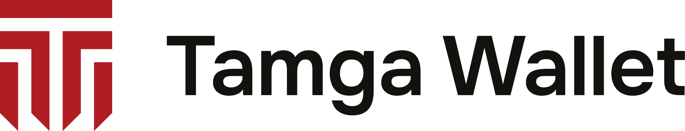

<picture>
  <source media="(prefers-color-scheme: dark)" srcset="./assets/tamga-wallet-lockup-on-dark.svg">
  
</picture>

### Show what's needed. Keep the rest.

An EU-compatible digital identity wallet — and the first wallet listed on [Tamga Network](https://tamga.network).

---

| | |
|---|---|
| **Your documents, on your phone** | Identity and institution credentials stay on the device, protected by its secure hardware |
| **Share only what's asked** | Selective disclosure and yes/no proofs — prove you are over 18 without revealing your date of birth |
| **Know who is asking** | Every request is checked against Tamga Network's signed lists before you decide |
| **In person or online** | Present over Bluetooth face to face, or to websites and apps over OpenID4VP |

### Contact

Support **[support@tamgawallet.com](mailto:support@tamgawallet.com)** · Security **[security@tamgawallet.com](mailto:security@tamgawallet.com)** · Privacy **[privacy@tamgawallet.com](mailto:privacy@tamgawallet.com)**
